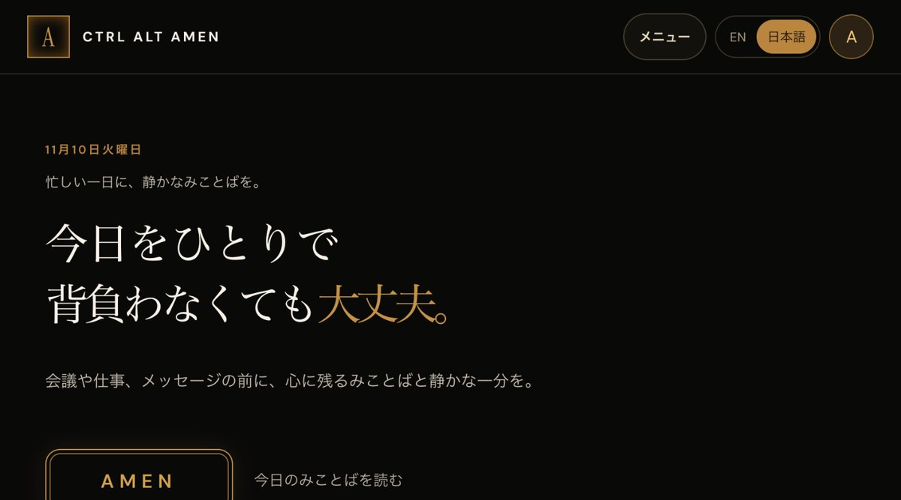

## どんなサービス？

「Ctrl Alt Amen」は、忙しい日の合間に、聖書のことばや祈り、振り返りの文章を読めるWebサイトです。日本語と英語の両方で読めます。Hikari Appsとして個人で制作しているOleg Ugrinさんが作りました。

トップページには「長い一日に、小さな光を」というコピーと、その日のことばが表示されます。「このサイトについて」のページでは、長時間の仕事や忙しさで疲れている人に向けて、励ましのことばを探さなくても日常の中で見つけられるようにしたい、と説明されています。信仰を「押しつけることではなく、招くこと」だとも書かれていて、聖書や祈りの内容は興味のある人が選んで読む形です。

*画像：Ctrl Alt Amen公式サイト（2026年11月10日に取得）*

> **あなたの個人開発サービスも、Yupirで紹介しませんか？**
> 掲載・PRのご相談は、[お問い合わせページ](https://yupir.tyokikaku.co.jp/contact/#interview)から受け付けています。

## できること

公式サイトとよくある質問のページによると、主な内容は次のとおりです。

- **今日のみことば：** 日付に合わせて選ばれた聖句と、その日のテーマ、祈り、感謝のことば、ひとことメモ
- **聖書リーダー：** 書巻と章を選んで読める。英語はBerean Standard Bible、日本語はフリーダム・バイブルが開き、KJV、ASV、文語訳、ロシア語シノド訳にも切り替えられる
- **ハイライトとブックマーク：** 節の一部だけ、または複数の節にまたがる文字を選んで色を付けられる
- **聖書アシスタント：** 気持ちやテーマ、言葉を入力すると、端末上で聖句を探してくれる。AIチャットではなく、個人向けの回答を生成したりノートを外部に送ったりはしない、と明記されている
- **学び：** 聖書の学び方や学びの資料、仕事の日の小さなガイド
- **私の歩み：** 保存したノート、ブックマーク、ハイライト、学習プランをまとめて確認できる

スマートフォンでは、ブラウザで開いて「ホーム画面に追加」を選ぶと、アプリのように使えるようになっています。

## 読むだけならアカウント不要

読む、検索する、学ぶ、ノートを下書きする、ハイライトする、ブックマークする、までの機能にアカウントは必要ありません。ゲストのハイライトやブックマークは、そのタブを開いている間だけ保持されます。

ノートやブックマーク、ハイライト、学習プランを保存して別の端末でも使いたいときは、ログインします。保存した記録はCSV・Excelに書き出せ、アカウントの削除もアカウント設定からできる、とよくある質問に書かれています。

## 料金

公開ページの利用は無料です。公式サイトに料金プランの記載はありませんでした（2026年11月10日に確認）。

## 同じ作者の、仕事を軽くするWindowsアプリ

Hikari Appsでは、Windows向けのアプリも2本公開しています。どちらも英語のUIで、Microsoft Storeで15日間の無料体験のあと、買い切りで使えます。サブスクリプションはありません。

- **Data Import Studio：** ExcelやCSVの整形手順をジョブとして保存し、翌月の同じファイルに使い回せる。列名が変わったときの確認や、共通のIDを使った2ファイルの比較もできる。体験後は14.99米ドル
- **Hanami Insights：** レビューのCSVやExcelを読み込み、キーワードごとの件数と元の文章を確認したり、期間を比較したりして、検索・コピーできるPDFの報告書にする。体験後は19.99米ドル

いずれも価格はMicrosoft Storeでの表示が優先されます。

## ここがポイント

「読む」までの間に何も要求してこない点です。アカウント登録もアプリのインストールもなく、開いた瞬間にその日のことばが表示されます。保存したくなったときだけログインすればよく、記録の書き出しやアカウントの削除までよくある質問に書かれているので、始めやすく、やめやすい作りです。

聖書に関心がある人はもちろん、「会議の前に1分だけ、静かな文章を読みたい」という人にも向いています。日本語版と英語版を切り替えて、同じことばを英語でも読んでみるとよさそうです。

> **このサービスのように、あなたのサービスも読者に届けませんか？**
> Yupirでは、個人開発のサービスを紹介しています。掲載・PRのご相談は[お問い合わせページ](https://yupir.tyokikaku.co.jp/contact/#interview)から。

## リンク

- 公式サイト: [Ctrl Alt Amen（日本語）](https://www.ctrlaltamen.com/ja/)
- 使い方とよくある質問: [Ctrl Alt Amen FAQ](https://www.ctrlaltamen.com/ja/faq)
- Windowsアプリ: [Data Import Studio](https://www.hikariapps.com/data-import-studio) / [Hanami Insights](https://www.hikariapps.com/hanami-insights)

> **個人開発のサービスを作った方へ**
> Yupirで、あなたのサービスも紹介しませんか。掲載・PRのご相談は[お問い合わせページ](https://yupir.tyokikaku.co.jp/contact/#interview)から受け付けています。
