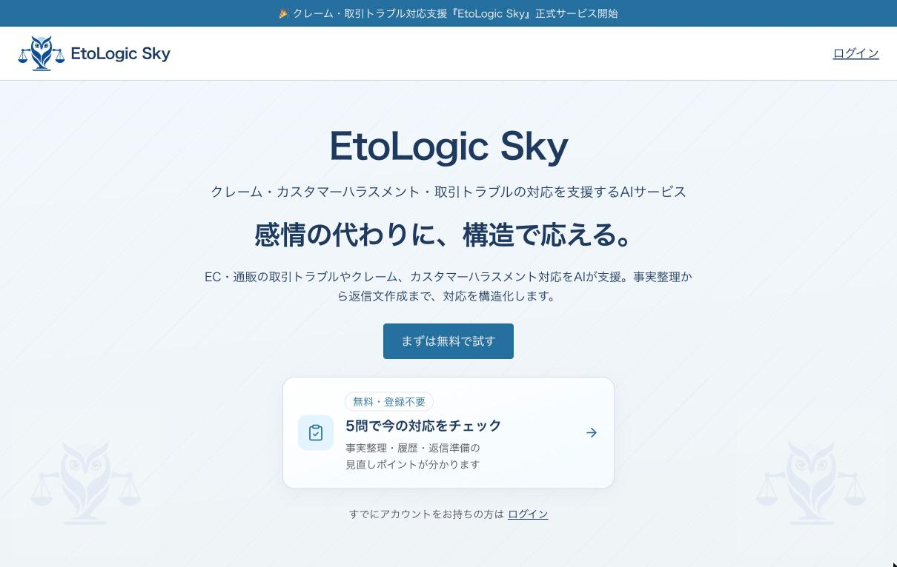
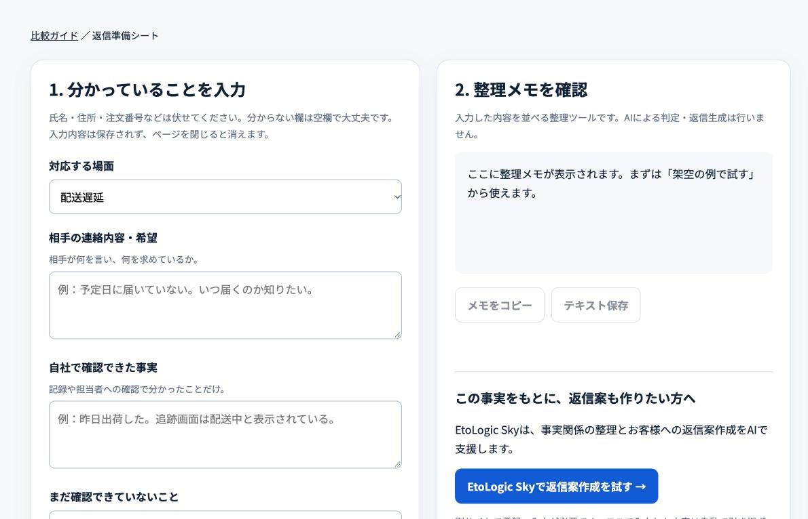

## どんなサービス？

「EtoLogic Sky（エトロジックスカイ）」は、EC・通販の事業者に届く配送遅延、商品破損、返品・交換、返金の相談などに返信するとき、状況の整理と返信文案づくりをAIで支援するWebサービスです。個人の開発者、江藤健一さんが開発・運営しています。

公式サイトに掲げている言葉は「感情の代わりに、構造で応える。」。強い怒りがこもった文章を受け取ったときほど、すぐに書き返したくなります。EtoLogic Skyは、返信を書く前に、相手の連絡を事実・証拠・時系列に分けて並べ直し、そのうえで冷静な一次返信の下書きを作る、という順番で使う作りになっています。

*画像：EtoLogic Sky公式サイト（2026年10月29日に取得）*

> **あなたの個人開発サービスも、Yupirで紹介しませんか？**
> 掲載・PRのご相談は、[お問い合わせページ](https://yupir.tyokikaku.co.jp/contact/#interview)から受け付けています。

## できること

公式サイトによると、次のような機能があります。

- **状況の整理：** 届いた連絡の内容を、事実・証拠・時系列の観点で整理する
- **返信文の作成：** 整理した内容をもとに、根拠のある一次返信の文案を作る
- **対応の標準化：** 担当者によって返信の内容がばらつかないようにする
- **履歴の記録：** 実際に送った返信を案件ごとに保存し、マイページで見返したり削除したりできる。続きの連絡が来たら、保存した経緯を踏まえて相談できる
- **口コミへの返信：** Googleマップなどの口コミ・レビューへの返信文づくりにも使える

使う流れは、困った連絡が届く → 状況を整理する → 返信案を作る → 送った返信を記録する → 続きの連絡があれば経緯を踏まえて相談する、の5段階です。

AIの機能を使うには登録が必要です。料金は、登録時に10ターン使えるFree（0円）のほか、Standard（月額1,980円・100ターン）、Pro（月額6,980円・400ターン）、Enterprise（月額12,800円・1,200ターン）が用意されています（いずれも税込、2026年10月28日に公式サイトで確認）。

## やらないことを、先に書いている

EtoLogic Skyは、できないことをはっきり書いているサービスです。個別の法律判断や法的な助言、相手との代理交渉、返信の自動送信は行いません。返信の最終確認と送信は利用者が行う前提です。訴訟や高額の請求、期限のある法的手続きが絡む場合は、専門家への相談を勧めています。

返信文を書くAIは便利な一方で、「AIが書いたものをそのまま送ってしまう」のが怖いところです。送るボタンを人の側に残し、AIの役割を整理と下書きに絞っているので、事業者が自分の言葉として責任を持って返信できます。

## 登録不要の「返信準備シート」もある

関連する無料ツールとして、「EC・通販の返信準備シート」も公開されています。こちらはAIを使わない整理用のツールで、登録も要りません。

対応する場面（配送遅延、返品・交換・返金、商品破損、誤配送・不足）を選び、相手の連絡内容と希望、自社で確認できた事実、まだ確認できていないこと、確認した規約・対応ルール、次にやることを書き込むと、整理メモにまとまります。メモはコピーしたりテキストで保存したりできます。ページの説明では、入力内容は外部に送信されず、ページを閉じると消えます。

*画像：EC・通販の返信準備シート（2026年10月29日に取得）*

AIで返信文まで作りたい人はEtoLogic Sky、まずは頭の中を整理したい人は返信準備シート、と使い分けられます。

## ここがポイント

返信の前に「確認済みの事実」と「相手の要望」と「まだ分からないこと」を分けるところです。クレーム対応で行き違いが起きるのは、確認できていないことを返信の中で約束してしまったときです。EtoLogic Skyも返信準備シートも、書く前にこの3つを分けさせる作りになっていて、焦って返信するのを防いでくれます。

ひとりで店を回している個人事業主にとって、強い言葉のメールに向き合うのは負担の大きい仕事です。無料の返信準備シートから試せるので、まずは次に届いた問い合わせで使ってみるのがよさそうです。

> **このサービスのように、あなたのサービスも読者に届けませんか？**
> Yupirでは、個人開発のサービスを紹介しています。掲載・PRのご相談は[お問い合わせページ](https://yupir.tyokikaku.co.jp/contact/#interview)から。

## リンク

- サービス: [EtoLogic Sky](https://etologic-sky.vercel.app/)
- 無料ツール: [EC・通販の返信準備シート](https://customer-support-ai-guide.deepforest9999.chatgpt.site/tools/reply-prep/)
- 開発者のX: [@EtoLogicSky](https://x.com/EtoLogicSky)

> **個人開発のサービスを作った方へ**
> Yupirで、あなたのサービスも紹介しませんか。掲載・PRのご相談は[お問い合わせページ](https://yupir.tyokikaku.co.jp/contact/#interview)から受け付けています。
