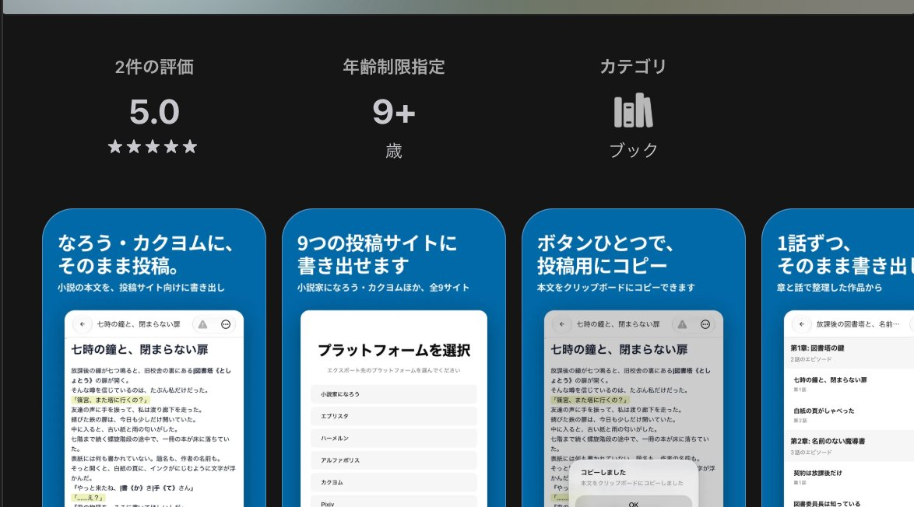

## どんなサービス？

「Handy」は、Web小説を書く人のための小説執筆ツールです。本文を書くエディタ、章・シーン単位のプロット、登場人物や世界観などの資料、メモ、タスクを、ひとつの場所にまとめて管理できます。個人開発者のKenya Hayashiさんが開発しています。

公式サイトでは「世界を創ろう」というコピーとともに、物語の構想から執筆、推敲、投稿先に合わせた書き出しまでを、PCとスマートフォンを行き来しても途切れさせずに進められる、と紹介されています。

*画像：App Store「Handy - 小説執筆エディタ」（2026年11月10日に取得）。開発者名の部分は除いています*

> **あなたの個人開発サービスも、Yupirで紹介しませんか？**
> 掲載・PRのご相談は、[お問い合わせページ](https://yupir.tyokikaku.co.jp/contact/#interview)から受け付けています。

## できること

公式サイトとApp Storeのページによると、主な機能は次のとおりです。

- **本文エディタ：** 「」で囲んだセリフが常にハイライト表示され、ルビは太字で強調される。傍点にも対応
- **@メンション：** 資料に登録した登場人物や地名などの名前を、@を打つと予測入力できる
- **プロット管理：** 章やシーンごとに物語の流れを整理し、伏線や展開を見失わずに書ける
- **資料管理：** 人物、国、アイテムなどを階層型フォルダで整理し、画像やタグも登録できる。資料どうしの関係やバックリンクも確認できる
- **執筆しながら参照：** 執筆画面の横に資料パネルを開いたまま、本文を書き進められる
- **メモとタスク：** メモはエピソードと紐付けられ、タスクはサブタスクを何階層でも作れる
- **テーマ：** ライト、ダーク、高コントラストの3種類

バージョン履歴やテンプレートなど、公式サイトで「Coming Soon」と表示されている機能もあります。現在は横書きのみです。

## iPhone版は登録なし、オフラインでも書ける

HandyはWebブラウザと、iPhoneアプリ（App Store・無料）で使えます。公式サイトにはGoogle Playのリンクもあります。

iPhone版はアカウント登録なしで始められます。執筆データは端末の中に保存されるため、通信のない場所でも本文や資料を編集できます。Web版とデータを同期したいときは、メール、Google、Appleのいずれかで同期アカウントをつなぐ形で、クラウド同期は任意です。

## 9つの投稿サイト向けに書き出せる

App Storeの説明によると、iPhone版は本文を次の9つの投稿サイト向けに変換して書き出せます。小説家になろう、カクヨム、pixiv、エブリスタ、アルファポリス、ハーメルン、ノベルアップ＋、fujossy、フォレストページ＋です。

ルビや傍点の記法は投稿サイトごとに違うので、1つの原稿から各サイトの形式に合わせて出せるのは、複数のサイトに投稿している人にとって手間が減る部分です。

## 料金

アカウント登録は無料です。料金プランのページには、今後有料サービスを提供する場合は内容・料金・支払方法などを事前にサイトで案内する、と書かれています（2026年11月10日に確認）。iPhoneアプリも無料で、App Storeのページにアプリ内課金の記載はありませんでした。

対応環境は、iPhoneがiOS 16.4以降です。Web版はGoogle Chromeの最新版が推奨されています。

## ここがポイント

本文を書く場所と、設定資料を置く場所が離れていない点です。小説を書いていると、登場人物の名前や設定を別のメモやスプレッドシートに探しに行くことが増えます。Handyでは資料を横に開いたまま書け、名前は@メンションで呼び出せるので、書く手を止めずに済みます。

iPhone版は登録なしで始められるので、まずは短い話を1本、資料を登録しながら書いてみるとよさそうです。

> **このサービスのように、あなたのサービスも読者に届けませんか？**
> Yupirでは、個人開発のサービスを紹介しています。掲載・PRのご相談は[お問い合わせページ](https://yupir.tyokikaku.co.jp/contact/#interview)から。

## リンク

- 公式サイト: [Handy](https://www.handy.light-novel.co/)
- アプリ: [Handy - 小説執筆エディタ（App Store）](https://apps.apple.com/jp/app/id6799161042)
- 開発者のX: [@Handy_editor](https://x.com/Handy_editor)

> **個人開発のサービスを作った方へ**
> Yupirで、あなたのサービスも紹介しませんか。掲載・PRのご相談は[お問い合わせページ](https://yupir.tyokikaku.co.jp/contact/#interview)から受け付けています。
