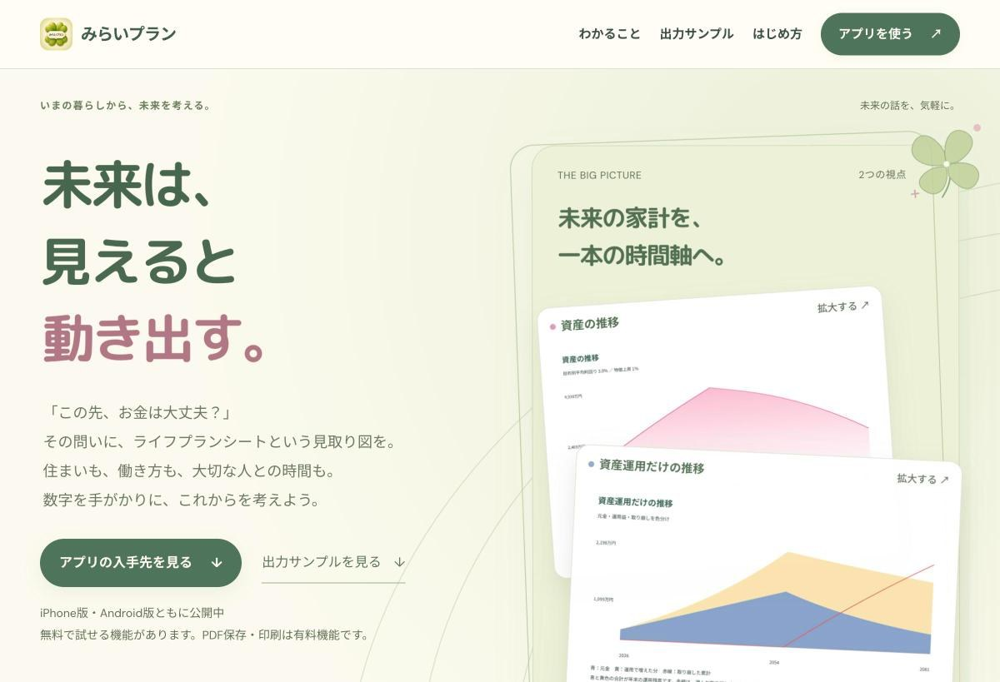
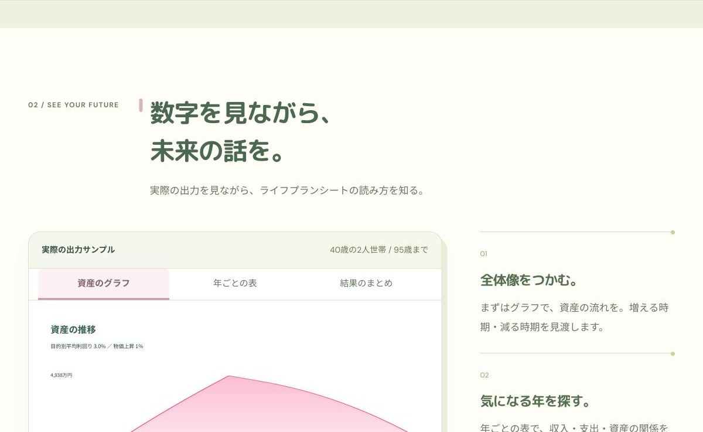

## どんなサービス？

「みらいプラン」は、これからのお金の流れを年ごとに試算するライフプランシートのアプリです。収入、支出、貯蓄、投資、住まい、家族の予定を入力すると、年ごとの収支と資産の変化が表とグラフで表示されます。「お金の設計屋」の名前で、個人が開発しています。

公式サイトでは、このアプリを「暮らしの条件を変えながらこれからの道を見比べるライフプランシートアプリ」と説明しています。日々の支出を記録する家計簿ではなく、先の見通しを立てるための道具です。

*画像：みらいプラン公式サイト（2026年11月13日に取得）*

> **あなたの個人開発サービスも、Yupirで紹介しませんか？**
> 掲載・PRのご相談は、[お問い合わせページ](https://yupir.tyokikaku.co.jp/contact/#interview)から受け付けています。

## できること

公式サイトとアプリストアの説明によると、主な機能は次のとおりです。

- **2つの入力のしかた：** カフェで相談するような簡易な「カフェカウンセリング」で大まかな数字を入れ、必要に応じて「じっくりカウンセリング」で細かく見直せる
- **細かさを選べる入力：** 生活費は合計でも項目別でも入力でき、投資の金額はまとめても、使う目的ごとに分けても入力できる
- **試算の前提を決める：** 物価上昇率と、何歳まで計算するかを設定できる
- **3つの見方で確かめる：** 結果は資産のグラフ、年ごとの表、結果のまとめで確認できる
- **条件を変えて比べる：** 住まいや働き方などの条件を変えて、いくつかの将来の形を比べられる

公式サイトには、40歳の2人世帯が95歳まで試算した出力サンプルが載っていて、グラフと表を実際に切り替えて見られます。

*画像：みらいプラン公式サイト（2026年11月13日に取得）*

## 無料で使える範囲

アプリは無料でダウンロードでき、簡易なカウンセリングや、年ごとの収支と資産の推移の確認は無料で使えます。じっくりカウンセリングの結果は、無料では合わせて3回まで確認できます。この回数は毎月増えるものではありません。

有料のプレミアムにすると、じっくりカウンセリングの結果を回数の制限なく確認でき、広告も表示されなくなります。PDFでの保存と印刷もプレミアムの機能です。料金は自動更新の定期購入で、App Storeでは年額2,980円のプランが表示されています。

iPhone版はiOS 15.0以降に対応しています。

## 試算は「見通しを立てるため」のもの

公式サイトとアプリストアの説明では、結果は入力した条件と一定の仮定にもとづく概算で、将来の運用成果や年金額などを保証するものではないと書かれています。税金や社会保障の制度、物価、投資の結果は変わる可能性があること、金融商品や保険、ローンの勧誘ではないことも明記されています。

数字をそのまま信じるためというより、「この条件ならどうなるか」を落ち着いて考えるための道具として使うのがよさそうです。

## ここがポイント

住まい、子ども、働き方といった暮らしの条件を、1本の時間軸の上でまとめて見られる点です。「この先、お金は大丈夫か」という漠然とした不安も、年ごとの表にすると、どの年の収支が苦しくなるのか、どこで資産が減り始めるのかが具体的に見えてきます。

まずはカフェカウンセリングで大まかな数字を入れて、自分の家計の流れを一度見てみると、次に何を考えればいいかがわかりやすくなりそうです。

> **このサービスのように、あなたのサービスも読者に届けませんか？**
> Yupirでは、個人開発のサービスを紹介しています。掲載・PRのご相談は[お問い合わせページ](https://yupir.tyokikaku.co.jp/contact/#interview)から。

## リンク

- 公式サイト: [みらいプラン](https://mirai-plan.yamamosora.chatgpt.site/)
- App Store: [みらいプラン](https://apps.apple.com/jp/app/id6826963033)
- Google Play: [みらいプラン｜ライフプランシート](https://play.google.com/store/apps/details?id=jp.yamamoto.miraiplan)

> **個人開発のサービスを作った方へ**
> Yupirで、あなたのサービスも紹介しませんか。掲載・PRのご相談は[お問い合わせページ](https://yupir.tyokikaku.co.jp/contact/#interview)から受け付けています。
