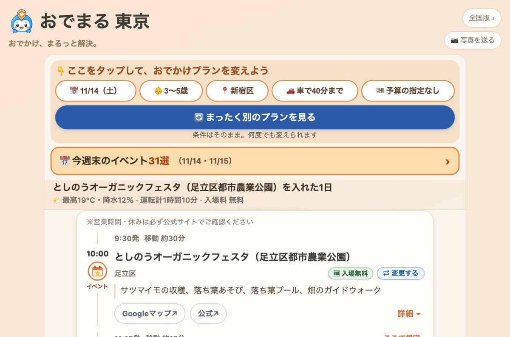

## どんなサービス？

「おでまる」は、子連れのおでかけを1日の予定として組んでくれるWebサービスです。出発地、子どもの年齢、車での移動時間、予算などを選ぶと、遊び場、昼食のお店、もう1か所の行き先までをつないだプランが表示されます。愛知県で子育てをしている平野翔大さんが、個人で開発・運営しています。

週末の行き先を1つ見つけても、昼食と帰宅までの段取りは残ったまま。そんな自身の経験から作り、愛知県向けのサイトから全国版へ広げたと、メディア向けページで説明されています。

*画像：おでまる公式サイト（2026年11月10日に取得）*

> **あなたの個人開発サービスも、Yupirで紹介しませんか？**
> 掲載・PRのご相談は、[お問い合わせページ](https://yupir.tyokikaku.co.jp/contact/#interview)から受け付けています。

## できること

公式サイトとメディア向けページによると、主な機能は次のとおりです。

- **質問に答えてプランを作る：** 出発地、車での移動時間の上限、日付、子どもの年齢の4つを選ぶと、約30秒で1日のプランができる
- **条件を変えて作り直す：** 条件はそのままに「まったく別のプランを見る」ことも、日付や年齢などを個別に変えることもできる
- **天気に合わせる：** 天気に応じてプランの内容が変わる。プランには最高気温と降水確率も表示され、雨の日に使える屋内スポットも地図から探せる
- **今週末のイベント：** 開催日・料金を公式で確認したイベントだけが載り、条件が合えばプランにも入る
- **共有と手動編集：** できたプランはURLやLINEで共有でき、地図からスポットを選んで自分で組むこともできる

掲載されているのは、公園、児童館、屋内施設、子連れで入りやすい飲食店などです。各スポットにはGoogleマップと公式サイトへのリンクが付いていて、プランの画面には「営業時間・休みは必ず公式サイトでご確認ください」と注意書きがあります。

## 全国47都道府県、登録不要で無料

対応エリアは全47都道府県で、掲載スポットは17,907件（うち愛知県1,318件）です。愛知県は、もともとの地域版サイト（旧「あいち子育ておでかけマップ」）につながるようになっています。

利用は無料で、アカウント登録やアプリのインストールは不要です。スマホのブラウザで開いて、そのまま使えます。

## 利用者数は公開されている

メディア向けページには、GA4で計測した月ごとのアクティブユーザー数が載っています。全国版は、2026年8月19日の公開から同月末までが98人、9月が1,586人、10月が11,946人でした。愛知版と合わせた10月の重複を除いた人数は14,524人で、10月のセッションの約88%が検索からの流入だったとされています。広告は出していないそうです。

個人で運営するサービスで、ここまで数字を開示しているのは珍しいと感じました。

## ここがポイント

「行き先を探す」で終わらず、「1日の段取りを決める」ところまで面倒を見てくれる点です。子連れのおでかけは、遊び場そのものより、昼ごはんをどこで食べるか、何時に出て何時に帰るか、といった段取りで悩みがちです。おでまるは、その段取りを最初から1本の流れにして見せてくれます。

条件を変えて何度でも作り直せるので、まずは自分の地域で、今週末の日付を入れて試してみるとよさそうです。

> **このサービスのように、あなたのサービスも読者に届けませんか？**
> Yupirでは、個人開発のサービスを紹介しています。掲載・PRのご相談は[お問い合わせページ](https://yupir.tyokikaku.co.jp/contact/#interview)から。

## リンク

- 公式サイト: [おでまる](https://kosodate-odekake.jp/)
- メディア・取材の方へ: [おでまる 取材資料](https://kosodate-odekake.jp/press/)
- Instagram: [@odemaru_odekake](https://www.instagram.com/odemaru_odekake/)

> **個人開発のサービスを作った方へ**
> Yupirで、あなたのサービスも紹介しませんか。掲載・PRのご相談は[お問い合わせページ](https://yupir.tyokikaku.co.jp/contact/#interview)から受け付けています。
