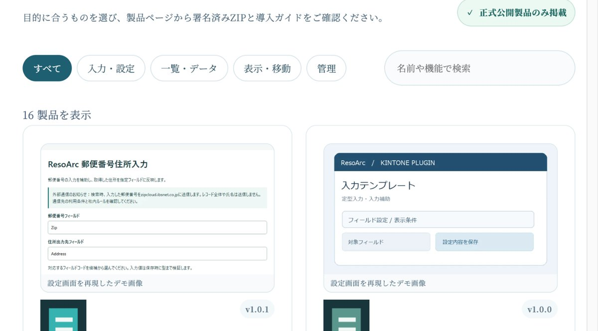

## どんなサービス？

「ResoArc（レゾアーク）」は、kintoneで使える無料のプラグインを公開している、独立した開発プロジェクトです。公式サイトでは「面倒な操作を少しだけ減らす、無料のkintoneプラグイン」と紹介されていて、2026年11月10日時点で16製品が公開されています。

運営は「ResoArc Open Technology Project」という活動名義で、匿名で開発しているとのことです。公式サイトには「法人・財団・公的機関ではありません」「サイボウズの公式製品・認定品ではありません」と明記されています。運営者の肩書きではなく、成果物、変更履歴、問題報告への対応で信頼を得る、という方針だそうです。

*画像：ResoArc公式サイト（2026年11月10日に取得）*

> **あなたの個人開発サービスも、Yupirで紹介しませんか？**
> 掲載・PRのご相談は、[お問い合わせページ](https://yupir.tyokikaku.co.jp/contact/#interview)から受け付けています。

## 公開されている16製品

公式サイトの一覧によると、公開中のプラグインは次のとおりです（かっこ内はバージョン）。

- **郵便番号住所入力（v1.0.1）：** 日本郵便の公開データで住所候補を探し、指定フィールドに反映する
- **入力テンプレート（v1.0.0）：** 定型の入力を入力パターンで効率化する
- **レコード再利用制御（v1.0.0）：** レコード再利用時に指定した項目を初期化する
- **メール作成ボタン（v1.0.0）：** レコードからメール作成画面を開く
- **タブ表示（v1.0.0）：** フィールドをタブで切り替えて整理する
- **自動採番（v1.0.0）：** レコードIDを使って通常フィールドを採番する
- **入力文字自動整形（v0.1.4）：** 保存時に文字の表記と空白を整える
- **フィールド説明表示（v0.1.3）：** 項目の下に説明や入力例を出す
- **ルックアップ候補表示（v0.1.5）：** 関連アプリから候補を検索して選ぶ
- **CSVワンクリック出力（v0.1.5）：** 表示中の一覧をCSVで保存する
- **一覧合計バー（v0.1.4）：** 一覧の件数や数値を集計する
- **添付ファイル有無表示（v0.1.4）：** 一覧上で添付の有無と件数を確認する
- **レコード目次（v0.1.3）：** 項目の多いレコード内を素早く移動する
- **保存後画面遷移（v0.1.3）：** 保存後に一覧や新規作成画面へ進む
- **関連アプリリンク（v0.1.3）：** レコードの値に応じて関連ページへリンクする
- **QRコード生成（v0.1.3）：** 値やURLをQRコードに変換する

1つのプラグインが1つの機能を受け持つ作りなので、必要なものだけを選んで入れられます。製品ごとに署名済みのZIPと導入ガイドが公式サイトに用意されています。

## 新製品の「郵便番号住所入力」

2026年11月9日に正式公開されたのが、郵便番号住所入力 v1.0.1です。郵便番号を入力すると住所候補を検索でき、選んだ住所を指定したフィールドに反映します。

製品ページによると、検索には日本郵便が公開している郵便番号データを使い、データはプラグインに同梱されています（2026年10月30日時点の更新分）。同梱データは自動では更新されないので、最新の住所に合わせるには更新版を導入する必要がある、とされています。候補が複数ある場合や住所が確定しない場合は、利用者側で内容を確認する前提です。

## 導入のしかたと注意点

導入手順は製品ページに書かれています。レコードと設定のバックアップを取り、まずテストアプリで試したうえで、kintoneのシステム管理で署名済みZIPを解凍せずに登録し、対象アプリに追加して設定を確認する流れです。

利用にはkintoneのプラグインが使える契約・環境が必要で、単体で動くアプリではありません。ゲストスペースや他のプラグインとの組み合わせについては、すべての環境での動作を保証しないとされています。製品ページには、SHA-256のハッシュ値と署名プラグインIDも記載されているので、ダウンロードしたZIPの照合ができます。

## 料金とライセンス

製品はすべて無料で、MITライセンスで提供されています。対応するソースのZIPも公開されていて、プロジェクトの正式な公開先はCodebergです。不具合の報告や改善の提案は、Codebergの公開Issueで受け付けているそうです。

## ここがポイント

「無料」だけでなく、「何がどう作られているかが見える」点です。署名済みZIP、ソースの公開、ハッシュ値の記載、動作を保証する範囲としない範囲の明記と、業務で使うツールに必要な情報がそろっています。匿名のプロジェクトだからこそ、説明と検証を公開する、という姿勢が製品ページの隅々に表れています。

kintoneで「この操作だけ、あと一歩ラクにしたい」と感じている人は、一覧から1つ選んでテストアプリで試してみるとよさそうです。

> **このサービスのように、あなたのサービスも読者に届けませんか？**
> Yupirでは、個人開発のサービスを紹介しています。掲載・PRのご相談は[お問い合わせページ](https://yupir.tyokikaku.co.jp/contact/#interview)から。

## リンク

- プラグイン一覧: [ResoArc kintoneプラグイン](https://resoarc.com/products/kintone/)
- 新製品: [郵便番号住所入力](https://resoarc.com/products/kintone/postal-address/)
- 公式サイト: [ResoArc](https://resoarc.com/)

> **個人開発のサービスを作った方へ**
> Yupirで、あなたのサービスも紹介しませんか。掲載・PRのご相談は[お問い合わせページ](https://yupir.tyokikaku.co.jp/contact/#interview)から受け付けています。
