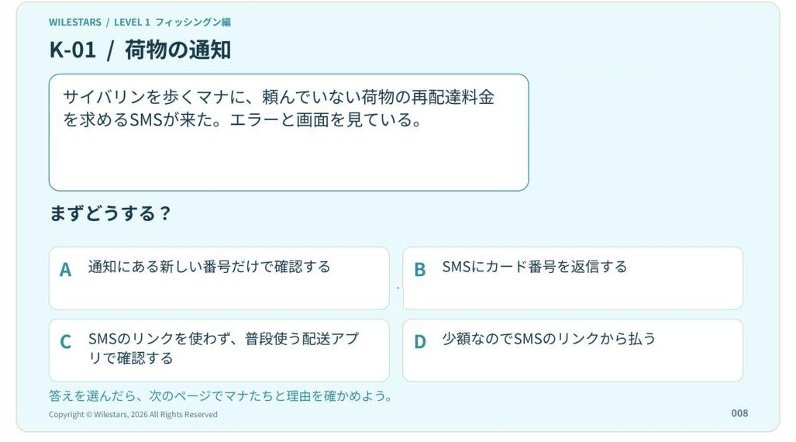

## どんなサービス？

「WILESTARS（ウイルスターズ）」は、英語とセキュリティをいっしょに学ぶ、個人制作の作品です。サイトでは、物語マンガ、学習マンガ、ゲーム、用語図鑑、音楽などを通して、セキュリティの知識と英語を学べるとされています。公式サイトでは、英語教育のメソッド「Affinity English」をもとにしていると紹介されています。

この記事で紹介するのは、そのうち無料で読める「公開見本」のページです。ページのタイトルは「マナと1問。理由まで、いっしょに。」。有料の会員向けの内容や、販売している学習ブックは、この記事では扱いません。

*画像：WILESTARS公式サイト（2026年11月4日に取得）。キャラクターのイラスト部分は除いています*

> **あなたの個人開発サービスも、Yupirで紹介しませんか？**
> 掲載・PRのご相談は、[お問い合わせページ](https://yupir.tyokikaku.co.jp/contact/#interview)から受け付けています。

## 公開見本では何をする？

公開見本は、1つの場面から考える形になっています。ページの流れは次の3つです。

1. **場面を読む・選ぶ：** 登場人物のマナのもとに、頼んでいない荷物の再配達料金を求めるSMSが届く。「この場面なら、どれを選ぶ？」と問われ、4つの選択肢から選ぶ
2. **会話で確かめる：** 選んだあとで、登場人物との会話を読みながら、その選択の理由を確かめる
3. **気に入ったら、次へ：** 気に入った人向けに、学習ブックへの案内が出る

選択肢には、カード番号を返信する、少額なのでリンクから支払う、といった危ない対応のほか、SMSの中のリンクを使わず、ふだん使っている配送アプリで確認する対応も並びます。選んだあとに開く解説ページには、正解と、会話による理由の説明があります。会話では、SMSの中のリンクを使わず、ふだん使う配送アプリで自分で確認する対応の理由が取り上げられています。

SMSの中に書かれた番号やリンクを使わず、自分で正規のアプリを開く。フィッシング詐欺の対策としてよく言われる行動を、「なぜそうするのか」まで含めて、場面と会話で考えられるのが特徴です。

## 日本語と英語の両方がある

同じ場面の公開見本は、日本語版と英語版（`/en/try-a-study-book/`）があります。日本語の公開見本ページには、同じ場面の英語と、文法・語彙の注釈もあります（「同じ場面を英語で確かめる」の欄）。英語版の見本でも、同じ場面の問題と会話による解説を無料で読めます。セキュリティの知識を日本語で確かめてから、同じ内容を英語で読み直す、という使い方ができます。

## 料金

公開見本は無料で、サイトによると、無料の内容は登録不要で読めます。ページには、同じ作品世界の有料の学習ブックへの案内もありますが、購入は任意で、見本を読むだけなら必要ありません。

## ここがポイント

セキュリティの話を「やってはいけないことの一覧」で終わらせず、場面の中で選び、理由まで会話で確かめるところです。迷ったときにどうするかは、ルールの暗記より、理由をわかっているほうが身につきます。そのうえで英語も同じ題材で学べるので、英語学習とフィッシング対策の両方に関心がある人に向いています。

見本は短く、登録なしで読めます。まずは日本語版で1問選んでみて、気になったら英語版でも読み比べてみるとよさそうです。

> **このサービスのように、あなたのサービスも読者に届けませんか？**
> Yupirでは、個人開発のサービスを紹介しています。掲載・PRのご相談は[お問い合わせページ](https://yupir.tyokikaku.co.jp/contact/#interview)から。

## リンク

- 無料の公開見本: [マナと1問。理由まで、いっしょに。](https://wilestars-jp.pages.dev/try-a-study-book/)
- 公式サイト: [WILESTARS](https://wilestars-jp.pages.dev/)
- X: [@wilestars_jp](https://x.com/wilestars_jp)

> **個人開発のサービスを作った方へ**
> Yupirで、あなたのサービスも紹介しませんか。掲載・PRのご相談は[お問い合わせページ](https://yupir.tyokikaku.co.jp/contact/#interview)から受け付けています。
